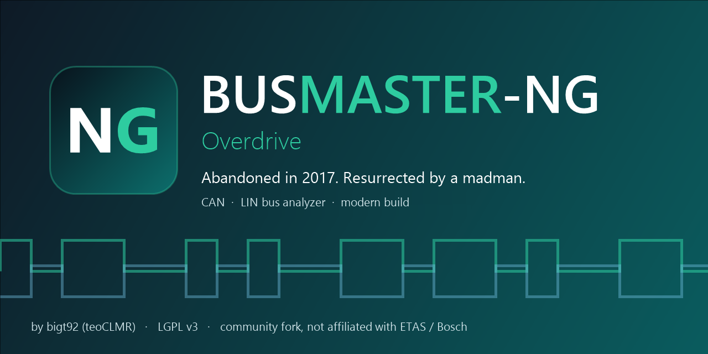

# BUSMASTER-NG



[](LICENSE)
[](https://github.com/teoCLMR/busmaster-ng/commits/master)
[](https://github.com/teoCLMR/busmaster-ng/issues)


**BUSMASTER-NG** (*Next Generation*, code name **Overdrive**) is a community-maintained fork of
[BUSMASTER](https://github.com/rbei-etas/busmaster), the open source tool for monitoring, analysing and
simulating CAN, LIN and FlexRay bus systems.

The original project has not been updated since 2017 (last release 3.2.2). BUSMASTER-NG keeps it alive:
modern build toolchain, bug fixes and maintenance.

> BUSMASTER-NG is an independent community project. It is **not affiliated with, endorsed by or
> supported by ETAS GmbH or Robert Bosch GmbH**. BUSMASTER is the work of its original authors; their
> copyright notices are preserved in the source files.

## Download

Get the ready-to-use program from [**Releases**](https://github.com/teoCLMR/busmaster-ng/releases): extract the
zip and start `BUSMASTER.exe`, no setup needed. It needs the *Microsoft Visual C++ 2013 Redistributable (x86)*
(most PCs already have it) and the driver of your CAN / LIN interface.

## Maintainer

- Developer name: **bigt92**
- GitHub: **teoCLMR**

## What is different from BUSMASTER 3.2.2

- Version **3.3.0**, product name BUSMASTER-NG, new splash screen, icon and installer artwork
  (the ETAS / Bosch logos are no longer used).
- Built with **Visual Studio 2022** (MSVC v143 toolset) and the Windows 10 SDK instead of Visual Studio 2013.
- Windows XP support removed.
- User data and settings are kept apart from earlier versions (folder and registry key of version 3.3.0),
  so BUSMASTER-NG can be installed next to BUSMASTER 3.2.2.
- The About dialog points to the original project and credits its authors.
- Configuration files (`.cfx`) of BUSMASTER 3.2.x open in BUSMASTER-NG (tested with real configurations).
- **DBC databases can be loaded directly**: *CAN → Load DBC* (or Ctrl+Shift+M) converts the DBC to a BUSMASTER
  database next to it and associates it, several files at once if you like. Configurations keep pointing to the
  `.dbf`, so they stay readable by BUSMASTER 3.2.x.
- **DBC ↔ DBF converters fixed**: numbers no longer depend on the language of Windows (on an Italian or German PC
  a factor of 0.5 became 0), factors and offsets keep all their digits (1e-7, -2105540607), 64-bit and Motorola
  signals convert correctly in both directions, and files that used to hang or crash the converter or come out
  empty now convert. Details and the upstream issues they close: [docs/dbc-support.md](docs/dbc-support.md).
- The **Format Converter** tool is built again (with Visual Studio 2022 it no longer compiled, so it was missing).

## Known limitations

- The **Japanese** language resources are not maintained or tested in this fork. They were already out of date
  with the code in BUSMASTER 3.2.2 (for example the Japanese About dialog lacks controls that the code expects),
  and have not been brought in line with the NG branding.
- The **Windows 7** build is checked on paper (no Windows 8+ imports) but not yet tested on a real Windows 7 PC.
- The images inside the help file (screenshots, logos) still come from the original BUSMASTER help.
- The installer script (`Installation Setup`) still uses the BUSMASTER name and texts.
- The database engine `DBManager.dll` is a closed binary of the original project. It keeps factors and offsets with
  about 7 significant digits, shows IEEE float/double signals as raw integers, refuses a database with CAN FD messages
  (more than 8 data bytes: on a CAN FD bus such frames are sent and received, but shown only as raw bytes) and shows every multiplexed signal whatever the multiplexer value. See
  [docs/dbc-support.md](docs/dbc-support.md).

## Requirements

- Windows 10 or 11. The release package is the *Windows 7 build* (see below), so it should also run on
  **Windows 7 SP1** (not tested yet). A build made with the newest Visual C++ 2022 toolset runs on Windows 10 or
  later only.
- On every Windows version the *Microsoft Visual C++ 2013 Redistributable (x86)* must be installed. The prebuilt
  components inherited from BUSMASTER (`libxml2.dll`, `DBManager.dll`, the PEAK driver `CAN_PEAK_USB.dll`) are
  built with that runtime, and `BUSMASTER.exe` loads `libxml2.dll` at start-up.
- The C++ / MFC 14.38 runtime and the Universal CRT are delivered next to the executable in the release package.
- The vendor driver of your CAN / LIN interface (PEAK, Vector, Kvaser, ETAS, ...), installed separately.

## Building

Install Visual Studio 2022 (Community is enough) with:

- the *Desktop development with C++* workload,
- *C++ MFC for latest v143 build tools (x86 & x64)*.

Then run `Sources\build.bat`, or open `Sources\Kernel\BusmasterKernel.sln` and
`Sources\BUSMASTER\BUSMASTER.sln` in Visual Studio and build the *Release* configuration.
The output is written to `Sources\BUSMASTER\BIN\Release`.

### Windows 7 build

The Visual Studio 2022 runtime from toolset 14.40 on needs Windows 8 or later (for example the C++ standard library
imports `GetSystemTimePreciseAsFileTime` and `CreateFile2`). For Windows 7 build with the older 14.38 toolset
(Visual Studio 2022 17.8), selected by a switch in `Sources\Directory.Build.props`.

Requirements on the build PC: the Visual Studio components *MSVC v143 ... (v14.38-17.8)* and the matching
*C++ ATL* and *C++ MFC* (v14.38) build tools.

1. Clean build with the switch (the toolset changes, so objects of the default build cannot be reused):

   ```
   MSBuild Sources\Kernel\BusmasterKernel.sln       /t:Rebuild /p:Configuration=Release /p:BusmasterWin7=true
   MSBuild Sources\BUSMASTER\BUSMASTER.sln          /t:Rebuild /p:Configuration=Release /p:BusmasterWin7=true
   ```

   `BusEmulation` (COM registration needs an administrator prompt) and `CAN_IXXAT_VCI` (vendor SDK) may fail; if
   `BUSMASTER.exe` was skipped because of that, build the project alone with
   `/t:Build /p:BuildProjectReferences=false /p:SolutionDir=<full path of Sources\BUSMASTER with a trailing />`.
   **Do the same for `CAN_STUB\CAN_STUB.vcxproj`** (the "Simulation" driver): it depends on `BusEmulation`, so the
   solution skips it after the clean has deleted `CAN_STUB.dll`. Without that DLL the application hangs at start-up
   with an empty trace window. Check that `BIN\Release\CAN_STUB.dll` exists before starting the program.
   A clean of the Application project deletes the tracked `BIN\Release\BUSMASTER.exe.manifest`; restore it with
   `git checkout -- Sources/BUSMASTER/BIN/Release/BUSMASTER.exe.manifest` before building the Application.

2. Assemble a self-contained folder (the output of step 1 is in `Sources\BUSMASTER\BIN\Release`). Copy that folder,
   without the intermediate files (`*.pch`, `*.ilk`, `*.pdb`, `*.exp`, `*.lib`), and add next to `BUSMASTER.exe`:
   - `msvcp140.dll`, `vcruntime140.dll`, `concrt140.dll` from `VC\Redist\MSVC\14.38.33130\x86\Microsoft.VC143.CRT`;
   - `mfc140.dll`, `mfc140u.dll`, `mfcm140.dll`, `mfcm140u.dll` from `...\Microsoft.VC143.MFC`;
   - all DLLs of `C:\Program Files (x86)\Windows Kits\10\Redist\ucrt\DLLs\x86` (the Universal CRT for
     application-local deployment, with `ucrtbase.dll` and the `api-ms-win-*` files).

3. On the Windows 7 PC install Windows 7 SP1 and the Visual C++ 2013 Redistributable (x86), then run the folder.

The result is checked with `dumpbin /imports`: none of the 36 compiled binaries, nor the 14.38 C++ / MFC runtime,
imports a function that is missing on Windows 7. It has **not been tested on a real Windows 7 machine yet**.
The default build and the Windows 7 build write to the same `BIN\Release` folder: do a clean build whenever you
switch between them.

Known build notes:

- `CAN_IXXAT_VCI` needs the IXXAT VCI SDK from the vendor (`vcinpl.h`); without it that driver is skipped.
- The post-build step of `BusEmulation` registers a COM server and needs an elevated (administrator) prompt.
- LDF Editor and LDF Viewer additionally need Qt 5.
- The PEAK driver (`CAN_PEAK_USB.dll`), `DBManager.dll`, `libxml2.dll` and the other vendor libraries in
  `BIN\Release` are prebuilt binaries inherited from BUSMASTER 3.2.2 (the PEAK driver has no sources in the
  repository), so they are not rebuilt with the new toolset.

## Hall of Madness

> *Every project needs a few stories. This one needs more than a few.*

BUSMASTER was last released in 2017. Everybody moved on. **One stubborn madman did not.** A short, honest list of
what it took to bring it back to life:

- **88 projects, one big jump.** From Visual Studio 2013 to Visual Studio 2022, with Windows XP left on the side of
  the road.
- **`About.ico` was an empty file.** Zero bytes, in the original repository. It has an icon now.
- **The help file refused to compile because of a single `%20`.** A help compiler from another era crashed with
  *"floating point not loaded"* and left half a file behind. The culprit was a space written as `%20` in the table
  of contents. Fixed, rebuilt, back online.
- **A 2011 MFC program at 200% DPI.** Tiny fonts, a Transmit window locked to exactly 860x655 pixels, tables that
  did not line up. Not anymore.
- **Windows 7, because someone still needs it.** The new C++ runtime imports two Windows 8 functions, so a second
  build with the older 14.38 toolset exists just for Windows 7 users. It is checked with `dumpbin` and waits for a
  real Windows 7 PC to be tested.
- **The signature.** *Made with stubbornness by **bigt92** (teoCLMR). Yes, it was me.*

*Next madmen:* fix a bug, add a feature, test a driver on real hardware, and your name goes here.

### Thanks

- **Night Man (Davide Clivio)**, friend and partner.
- **Salvatore Torsello** and **Nicolò Campanini**, former collaborators.

### Italiano

> *Ogni progetto ha qualche storia da raccontare. Questo ne ha parecchie.*

BUSMASTER è stato rilasciato l'ultima volta nel 2017. Tutti sono passati ad altro. **Un testardo pazzo no.** Ecco,
senza abbellimenti, cosa è servito per riportarlo in vita:

- **88 progetti, un grande salto.** Da Visual Studio 2013 a Visual Studio 2022, con Windows XP lasciato sul ciglio
  della strada.
- **`About.ico` era un file vuoto.** Zero byte, nel repository originale. Ora ha un'icona.
- **La guida non voleva compilarsi per colpa di un solo `%20`.** Un compilatore di guide di un'altra epoca andava in
  crash con *"floating point not loaded"* lasciando un file a metà. Il colpevole era uno spazio scritto come `%20`
  nel sommario. Sistemato, ricompilata, di nuovo online.
- **Un programma MFC del 2011 a 200% di DPI.** Caratteri minuscoli, una Transmit window bloccata esattamente a
  860x655 pixel, tabelle non allineate. Non più.
- **Windows 7, perché c'è ancora chi lo usa.** Il nuovo runtime C++ importa due funzioni di Windows 8, quindi esiste
  una seconda build con il vecchio toolset 14.38 solo per chi usa Windows 7. È controllata con `dumpbin` e aspetta un
  vero PC Windows 7 per essere provata.
- **La firma.** *Fatto con testardaggine da **bigt92** (teoCLMR). Sì, sono stato io.*

*I prossimi pazzi:* correggi un bug, aggiungi una funzione, prova un driver su hardware vero, e il tuo nome finisce qui.

### Ringraziamenti

- **Night Man (Davide Clivio)**, amico e socio.
- **Salvatore Torsello** e **Nicolò Campanini**, ex collaboratori.

## License

BUSMASTER-NG is distributed under the **GNU Lesser General Public License, version 3 or later**
(SPDX: `LGPL-3.0-or-later`), like the original project.

- `LICENSE` (identical to `COPYING.LESSER.txt`) is the text of the LGPL v3.
- `COPYING.txt` is the GNU GPL v3, whose terms the LGPL v3 builds on.
- The original copyright notices of ETAS GmbH and Robert Bosch Engineering and Business Solutions Limited are
  kept in the source files; the changes of BUSMASTER-NG are released under the same license.
- Third-party components keep their own licenses; see `Readme.txt`.
